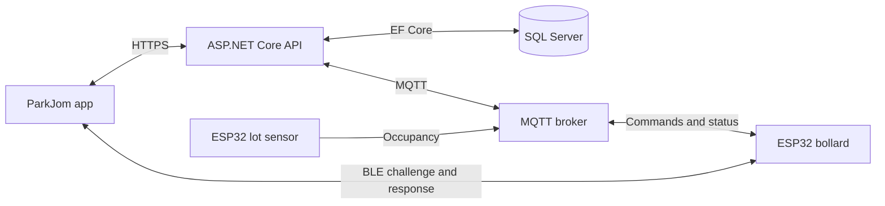

# ParkJom

I built ParkJom to help Klang Valley commuters find parking near LRT and MRT stations before they leave home. Drivers can reserve a private bay and unlock its smart bollard when they arrive, or check the latest availability at a public lot.

**[Live app at parkjom.web.app](https://parkjom.web.app)** · [Frontend source](https://github.com/ChunJIA614/ParkJom-Frontend)

This repository contains the backend and the ESP32 firmware.

[Features](#features) · [Architecture](#architecture) · [IoT and security](#iot-and-security) · [Installation](#installation) · [Usage](#usage) · [Contributing](#contributing) · [License](#license)

## Features

- **Find parking near transit.** Search by station or location, compare parking options and walking routes, and save favorites. The transit copilot can suggest where to park, and congestion forecasts combine typical demand patterns with current parking activity and weather.
- **Reserve and pay.** Check availability, get a quote, and book a private bay. Drivers can top up their wallet through Stripe, manage registered vehicles, cancel eligible bookings and review a spot after parking.
- **Manage parking as an owner.** Set prices and available dates, manage listing photos, see who has booked a bay on a given day, and track earnings and withdrawals.
- **Use public drive-in parking.** Check the latest sensor count, look up a parking session, and pay for it with the ParkJom wallet or Stripe. Owners can manage their lots and review active sessions.
- **Handle day-to-day operations.** Property managers can review bookings, check plates and inspect access events for their properties. ParkJom sends booking reminders, monitors overstays, and gives support staff tools to handle tickets, incidents and disputes.

## Architecture

I use an ASP.NET Core API to handle bookings, payments and permissions. SQL Server records those transactions along with device readings, so an owner can see the same booking the API checks when a renter asks to unlock.



| Area | Stack |
| --- | --- |
| Backend and storage | C#, .NET 9, ASP.NET Core, Entity Framework Core and SQL Server |
| Devices | Arduino ESP32 firmware, MQTTnet, PubSubClient, NimBLE, ultrasonic sensors and an SSD1306 OLED |
| Maps and transit | Nominatim geocoding, OSRM routing, GTFS schedules and GTFS-Realtime vehicle data |
| Trip assistance | Gemini for the copilot and ML.NET FastTree for congestion forecasts |
| Payments and media | Stripe for checkout and Cloudinary for photos and documents |
| Communication | SignalR, WebSockets, Web Push, SMTP and SMS360 |

## IoT and security

### What the devices do

- **Private bollard.** The ESP32 moves a servo when it receives a lock or unlock command. An ultrasonic check blocks the lock movement if something is in the way or the sensor cannot get a valid reading. The OLED shows the commanded lock state and the six-digit pairing code. Owners can view the last reported status or request a fresh scan. [Smart bollard firmware](iot/smart-bollard/smart-bollard.ino)
- **Public-lot sensor.** A separate ESP32 reads two ultrasonic sensors and publishes a timestamped occupancy count over MQTT. In a two-space lot, a count of one occupied space leaves one available. The UI can distinguish a fresh reading, a stale reading and an unknown count. [Public parking firmware](iot/public-parking/public-parking.ino)

### How a renter unlocks a bollard

1. **Register and pair the bollard.** The backend generates a random key when the device first registers. The ESP32 saves its copy for future boots. An owner presses the physical button and enters the short-lived code shown on the OLED to link the device to their bay. The backend checks ownership and limits pairing attempts.
2. **Check the booking and location.** When a renter requests an unlock, the API checks that their booking allows access at that time and that their phone reports a recent GPS reading near the property. It then creates a short-lived challenge for that renter, booking and bollard.
3. **Verify the Bluetooth response.** The phone passes the challenge to the bollard over BLE. The device uses HMAC-SHA256 and its saved key to calculate a response. The phone relays that response to the API. The shared key stays with the device and backend during this exchange.
4. **Authorize the movement.** The backend calculates its own response and compares it with the device's response. After a match, it consumes the challenge before sending the unlock command over MQTT. Each challenge expires and can be used only once.

I use Google sign-in, SMS phone verification, revocable JWT sessions, and role and ownership checks. The API verifies Stripe webhook signatures before processing payment events. Initial device registration relies on a device identifier, so first-time registration is intended for controlled setup.

## Installation

You'll need Git, the .NET 9 SDK, a local SQL Server instance with an empty development database, and the EF Core CLI. Install the CLI if needed. [EF Core CLI guide](https://learn.microsoft.com/en-us/ef/core/cli/dotnet)

```powershell
git clone https://github.com/junkerino1/ParkJomV2.git
cd ParkJomV2
dotnet tool install --global dotnet-ef --version 9.0.10
dotnet restore ParkJomV2/ParkJomV2.csproj
dotnet dev-certs https --trust
```

Set a development connection string and JWT signing key. Replace the two placeholders with your own values. The signing key should contain at least 32 random bytes. These commands store the settings in .NET User Secrets on your workstation.

```powershell
dotnet user-secrets set "ConnectionStrings:DefaultConnection" "<your development SQL Server connection string>" --project ParkJomV2
dotnet user-secrets set "JwtSettings:SecretKey" "<your random development signing key>" --project ParkJomV2
dotnet ef database update --project ParkJomV2 -- --environment Development
dotnet run --project ParkJomV2 --launch-profile https
```

For environment-based configuration, use `ConnectionStrings__DefaultConnection` and `JwtSettings__SecretKey`. Configure Google OAuth and SMS360 to exercise sign-in and phone verification, Stripe test credentials for payments, and a development MQTT broker and ESP32 for hardware flows. Set provider credentials in User Secrets or environment variables.

## Usage

**Try the hosted app.** Open ParkJom and start by searching for an LRT or MRT station. Explore nearby parking, then sign in to try booking or paying for a parking session. [Open the live app](https://parkjom.web.app)

**Try the backend locally.** Open Swagger after starting the API. For a quick check with no sign-in, send the request below to list rail routes from the bundled GTFS data. [Local Swagger UI](https://localhost:7250/swagger)

```powershell
curl.exe --fail https://localhost:7250/api/gtfs/routes
```

To run the UI locally, follow its setup instructions and point it at `https://localhost:7250`. The API allows local frontend requests from port `3000` by default. [Frontend repository](https://github.com/ChunJIA614/ParkJom-Frontend)

## Contributing

For a bug report or feature request, open an issue and describe the workflow, what you expected, and what happened. For a code change, open a pull request with a brief description and the checks you ran. [GitHub issues](https://github.com/junkerino1/ParkJomV2/issues)

## License

This repository currently has no published license. Contact the maintainer for permission before reusing, modifying or redistributing the code.
